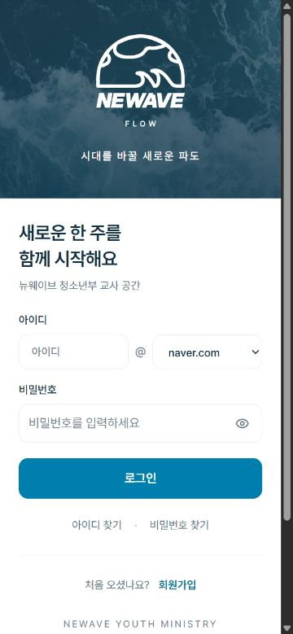
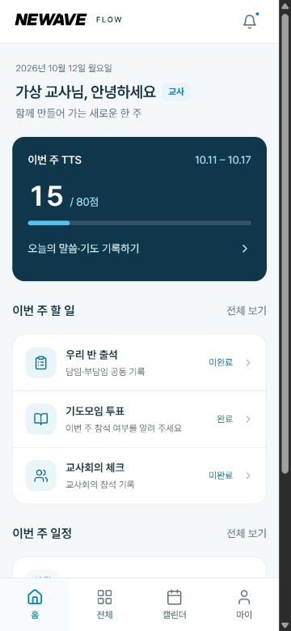
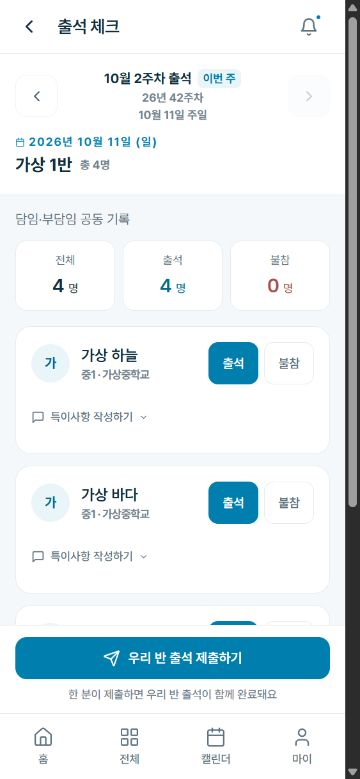
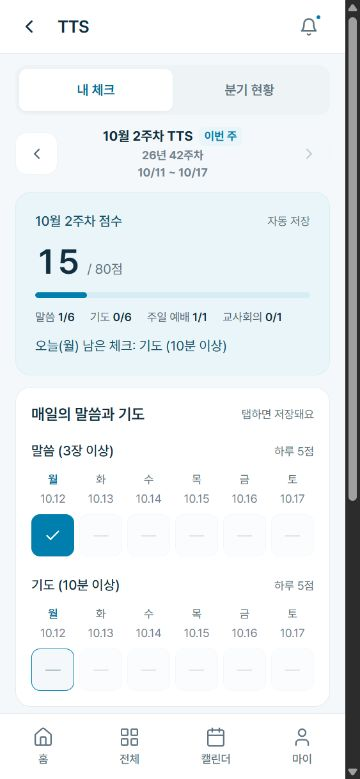

# NEWAVE 디자인 적용 및 검수 — 2026-10-12

## 완료 범위

승인한 V3 시안을 실제 React 화면에 적용했다. 이번 단계는 프런트엔드 변경이며, 운영 배포는 아직 하지 않았다.

| 단계 | 적용 내용 | 확인 결과 |
|---|---|---|
| 1. 공통 디자인 | 원본 NEWAVE 로고, 남색·파랑 색상, 로컬 Pretendard 4종, 흰색 카드, 헤더·하단 메뉴·버튼 | 공통 요소 적용, 외부 폰트 CDN 의존 제거 |
| 2. 대표 화면 | 로그인, 홈, 출석, TTS 구조 변경 | 가상 데이터로 주요 이동·입력·저장 동작 확인 |
| 3. 나머지 화면 | 전체 메뉴·내 정보 정리, 관리·행사·교적부 등 공통 글자 크기·두께 조정 | 35개 페이지의 경로와 기본 렌더링 점검. 관리자 목록·반 배정 모달 별도 확인 |
| 4. 설치·이용 안내 | 원본 벡터 기반 앱 아이콘 180/192/512px, 파비콘, PWA 색상, 이용 안내 갱신 | 설치 아이콘 파일·매니페스트 참조·빌드 포함 여부 확인 |
| 5. 회귀 검수 | 자동 테스트, 빌드, 모바일·큰글씨·실패 상황 | 29개 테스트 통과, 배포용 빌드 통과, 변경 부분 공백 검사 통과 |

## 화면별 변경

- 로그인: 파도 사진과 원본 엠블럼, 흰색 입력 영역, 아이디·도메인 입력, 비밀번호 표시 버튼.
- 홈: 실제 이번 주 점수와 체크 화면 연결, 반 출석·기도모임·교사회의 상태, 일정 목록. 관리자 요약·바로가기 기능 유지. 조회 오류는 미완료 대신 확인 필요로 표시.
- 출석: 인원 요약, 출석·불참 버튼, 공동 기록 안내. 제출 영역을 하단 메뉴 위로 올려 메뉴 접근을 유지. 기존 기본 출석 값·저장 순서·반 공동 완료 기준 유지.
- TTS: 점수 진행 막대, 항목별 요일 칸, 저장 상태, 동일한 파랑 선택 색상. 질문·배점은 서버 자료를 사용. 분기 순위·주차별·내 추이와 시트 확정 기록 유지.
- 전체 메뉴: 두 열의 단정한 메뉴 카드. 내 정보: 남색 프로필 영역, 접근 가능한 큰글씨 스위치.
- 관리·행사·교적부: 공통 글자 두께를 900에서 700 이하로 정리하고 9~11px의 작은 안내를 확대. 상태·행사 분류에 의미가 있는 색상은 보존.
- 이용 안내: 이전 화면 캡처와 맞지 않는 설명을 현재 기능에 맞게 교체. 실제 화면으로 이동하는 링크와 인쇄 기능 제공.

## 함께 해결한 문제

1. 공통 Button에서 props를 마지막에 펼치면 loading으로 계산한 disabled가 덮어써질 수 있었다. 이제 loading 또는 disabled이면 비활성 상태를 유지한다.
2. 존재하지 않던 outline 버튼 스타일을 추가했다.
3. 화면 확대 차단과 큰글씨 모드의 버튼 글자 크기 강제 고정을 제거했다. AppLayout이 사라질 때 큰글씨 설정을 정리한다.
4. 출석 제출 버튼이 하단 메뉴를 덮던 배치를 수정했다.
5. 320px와 큰글씨에서는 TTS 요일 칸을 세 열로 배치하고 출석 선택 버튼을 별도 줄로 배치한다.
6. 새 헤더 높이에 맞춰 관리자 화면의 고정 탭 위치를 조정했다. 전환 애니메이션의 일시적인 가로 넘침을 컨테이너에서 제한했다.
7. TTS 내 추이에서 미기록을 0으로 표시하던 부분을 기록 없음으로 구분했다.
8. PWA 설정은 icon-192.png와 icon-512.png를 가리키지만 실제 파일이 없었다. 제공된 로고 벡터로 해당 파일과 Apple 터치 아이콘을 만들었다.

## 검수 근거

### 자동 검증

- frontend의 npm test: 29개 모두 통과.
- npm run build -- --outDir .verification/build: 성공.
- 일반 제한 환경의 Vite realpath EPERM 오류는 정상 파일 접근 권한으로 재실행하여 통과했다.
- 기존 Browserslist 데이터가 오래되었다는 안내 외에 빌드 오류 없음.
- 대표 변경 8페이지 외 나머지 27페이지는 표시 속성과 문구를 제외한 코드 구조를 기존 HEAD와 대조했다. 모두 동일했다. 이 대조가 모든 동작에 대한 자동 테스트를 대체하는 것은 아니다.
- backend, API 클라이언트, 라우터, 날짜·분기 유틸리티, 기존 추적 dist에 변경 없음.

### 브라우저 검증

실제 페이지 컴포넌트를 별도 메모리 라우터와 가상 응답으로 실행했다. 모든 API 요청은 로컬 가상 응답 처리기 안에서 끝나며 운영 서버에 전달되지 않는다.

| 항목 | 확인한 동작 |
|---|---|
| 로그인 | 도메인 직접 입력, 비밀번호 표시, 로그인 후 홈 이동 |
| 출석 | 가상 학생 4명 중 1명 불참 선택, 사유 입력, 3/1 집계, 제출, 재수정 시 사유 유지, 홈 공동 완료 표시 |
| TTS | 15점에서 기도 체크 후 20점 반영, 미래 요일 비활성, 41주차 확정 총점 읽기 전용 |
| 분기 | 2026년 4분기 표시, 2027년 1~4분기와 빈 기록 분리 |
| 실패 | TTS 저장 실패 후 선택 복구, 홈 조회 오류 안내, 출석 조회 실패 시 입력·제출 차단 |
| 행사 | 교사 참석 제출과 학생 출석 제출 완료, 부분 참석 날짜 미입력 시 제출 차단 |
| 관리 | 가상 교사·학생 목록, 반 배정 모달, TTS 관리·일정·안내 페이지 기본 표시 |
| 모바일 | 375px 기본 화면, 320px TTS 및 큰글씨 출석·내 정보에서 가로 넘침 없음. TTS 320px 칸 높이 44px 확인 |

검수용 페이지를 수정하던 중 개발 도구의 중복 root 경고가 발생해 검수 페이지의 교체 시 정리 코드를 추가했다. 운영 진입 파일에는 이 가상 응답 처리기나 검수 코드를 포함하지 않는다. 최종 새로고침에서 콘솔 오류는 없었고, React Router 다음 버전 전환에 관한 안내 경고 1건이 남았다.

검수 한계: 실제 운영 계정·DB 저장, 모든 관리 기능의 모든 조건, 휴대폰 실기기 설치·키보드·브라우저별 화면은 이번 로컬 UI 검수에 포함하지 않았다. 행사 부분 참석 날짜의 브라우저 자동 입력은 도구에서 빈 값으로 남아, 부분 참석 저장 완료까지는 검증하지 않았다. 일반 참석 제출과 날짜 미입력 차단은 확인했다.

## 결과 화면

이미지 안의 이름·점수·일정은 가상 자료다.

## 자산 출처

- 로고·워드마크: 제공된 Illustrator 자료에서 추출한 원본 벡터. V3 시안과 동일한 파일.
- 파도 사진: 제공된 유튜브 썸네일 자료에 포함된 사진. V3 시안과 동일한 파일.
- Pretendard: V3에서 사용한 400/500/600/700 정적 woff2. SIL OFL 라이선스 파일을 함께 포함.
- 설치 아이콘: 원본 로고에 남색 배경과 안전 여백을 적용해 벡터에서 렌더링. 로고를 새로 그리지 않음.

## 다음 단계

1. 커밋 방식 선택: PR로 미리보기 후 병합 또는 main 직접 푸시.
2. 선택한 방식으로 배포 후 로그인·출석·행사·TTS의 조회 화면을 운영 버전에서 확인.
3. Android·iPhone 실기기에서 설치 아이콘, 키보드, 큰글씨, 하단 안전 영역 점검.
4. 실제 사용 의견을 받아 표 밀도와 긴 이름·긴 항목의 세부 배치 조정.

운영 데이터, 출석 공동 완료 정책, TTS 2026년 4분기부터의 관리 기준, 정기 백업 설정은 변경하지 않았다.
